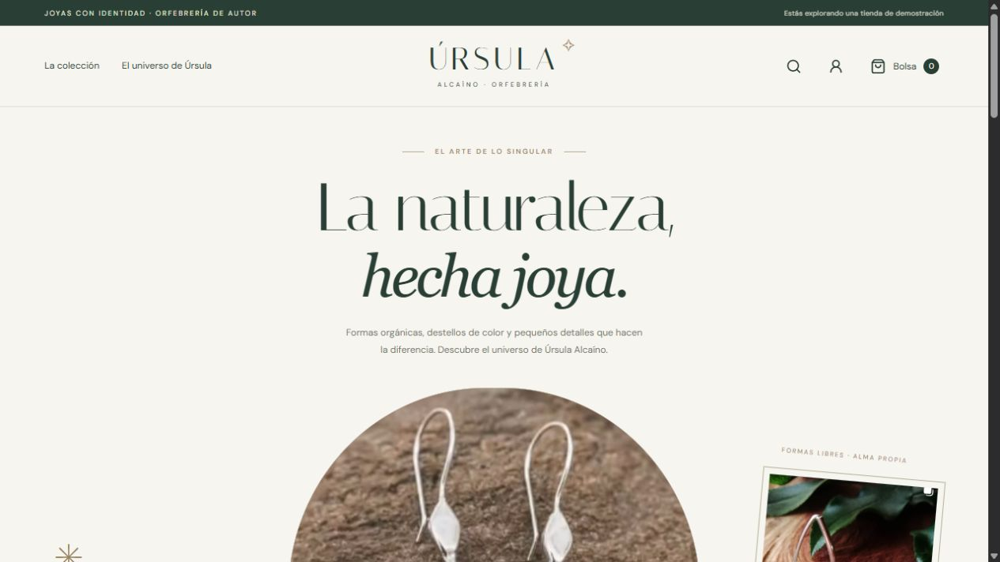
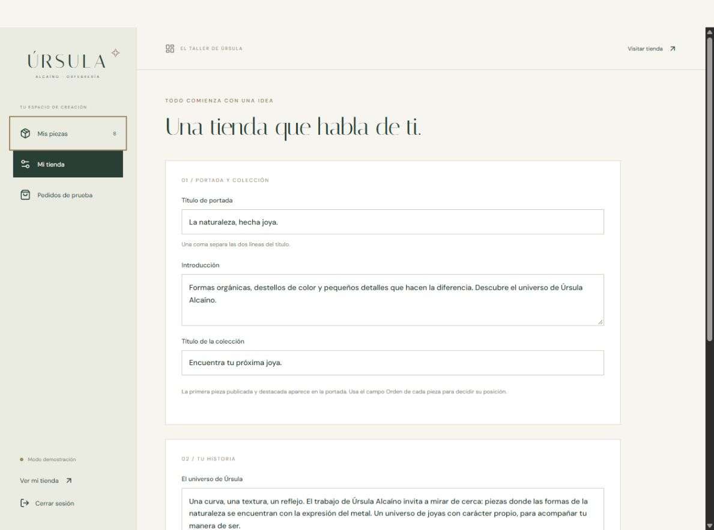

# Úrsula Alcaíno · Orfebrería

Propuesta de tienda para **Úrsula Alcaíno Orfebrería**: un diseño en marfil y verde profundo, fotografías protagonistas, catálogo de joyas, bolsa de compra y un taller privado para administrar el contenido.

**Estado: demostración funcional.** Los nombres, precios y stock iniciales son ejemplos editables. El pago se simula localmente, sin cobrar dinero ni conectarse a Mercado Pago. Este repositorio contiene el proyecto completo; todavía no hay una tienda pública desplegada.

## Vista previa





[Ver la página completa en móvil](review/tienda-movil.png)

## Ejecutar

Requiere Node 24 o superior y pnpm. Clona el repositorio y ejecuta:

```sh
git clone https://github.com/TakeruTK/PagOFUrsula.git
cd PagOFUrsula
pnpm install --frozen-lockfile
node scripts/setup-admin.mjs
pnpm dev
```

También puedes usar `npm install` y `npm run dev` si tienes npm disponible. La tienda está en `http://127.0.0.1:3002` y el taller en `/admin`. El proyecto es independiente y no requiere los archivos de la página utilizada como base.

Con las dependencias instaladas también puedes iniciarla directamente:

```sh
node node_modules/next/dist/bin/next dev --webpack --hostname 127.0.0.1 --port 3002
```

`setup-admin.mjs` genera un usuario `ursula` y muestra una contraseña aleatoria una sola vez. Guarda únicamente el hash en `.env.local`, excluido de Git. Si ya está configurado, no cambia nada. Para restablecerlo: `node scripts/setup-admin.mjs --reset`, y reiniciar el servidor. Las sesiones anteriores quedan invalidadas.

## Funciones

- Tienda adaptable a móvil, filtros, búsqueda, orden por precio, detalle de pieza, múltiples fotografías y bolsa persistida en el navegador.
- Compra de prueba con resultados aprobado, pendiente y rechazado. Usa un nombre y correo ficticios; no se envían correos.
- Panel protegido: crear/editar/eliminar piezas; hasta 8 fotografías; portada y pies de foto; categorías, materiales, precios, stock, disponibilidad y borradores; orden y destacados.
- La primera pieza destacada publicada es la fotografía principal; la siguiente es la secundaria. Si no hay piezas, la portada utiliza las referencias iniciales.
- Editar título e introducción de portada, título de colección, historia y perfil de Instagram.
- Consultar los últimos 200 pedidos simulados.

Los productos, fotos subidas, textos, sesiones y pedidos se guardan en `data/ursula.sqlite`. El archivo y sus auxiliares WAL/SHM son propios de esta tienda. Para otro directorio persistente configura `DATA_DIR`. Copiar la carpeta data con el servidor detenido para respaldarla. Este almacenamiento requiere un servidor Node con disco persistente: no es un deploy estático ni una configuración para Cloudflare Workers/D1.

## Mercado Pago: estado real

`PAYMENT_MODE=demo` es el único modo implementado. **No hay conexión a Mercado Pago, no hay cobros y no se piden tarjetas**. Cambiar el modo a cualquier otro valor bloquea la operación. El simulador no reserva ni descuenta inventario. El despacho se muestra como por coordinar y no se calcula.

La separación de proveedor está en `lib/payments.ts`. El servidor valida disponibilidad y cantidades, obtiene precios desde su catálogo y calcula el total; ignora precios enviados por el navegador. Una clave de idempotencia evita pedidos duplicados en reintentos y rechaza reutilizarla con otros datos.

Para el lanzamiento falta implementar y validar el proveedor real: credenciales privadas de Mercado Pago y cuenta de prueba; creación de preferencia en servidor; redirección a Checkout Pro; webhook verificado y consulta del pago a Mercado Pago para reconciliar monto, moneda, pedido y estado; idempotencia de eventos, reservas y actualización transaccional de stock. Nunca usar el retorno del navegador para confirmar el pago. También faltan acordar envíos, política de cambios/devoluciones, privacidad, dominio y correo de pedidos, y reemplazar el catálogo de ejemplo. Revisar la documentación oficial vigente al implementar. No poner tokens de Mercado Pago en el navegador ni en campos públicos del panel.

## Referencias y contenido

Las cinco capturas aportadas por el usuario están en `public/references/`. La tienda encuadra productos mediante vistas SVG y CSS, conserva las proporciones y las imágenes fuente y no genera fotografías ficticias. Los nombres de las piezas y los precios son ejemplos editoriales claramente identificados, y el stock inicial es de demostración. Los materiales y medidas no se afirman como confirmados. El texto de presentación es una propuesta para revisión de la autora, no una biografía verificada. La captura sobre Mercado Pago se conserva como referencia visual, no como evidencia de una integración activa en esta tienda.

Instagram: https://www.instagram.com/ursulaalcaino/ (el acceso automatizado al perfil fue bloqueado; se trabajó con las imágenes entregadas). Reemplazar capturas por fotografías originales antes del lanzamiento.

## Validación

```sh
pnpm typecheck
pnpm build
pnpm test
```

Las pruebas de integración levantan la compilación de producción en el puerto 3013 con credenciales aleatorias y una base aislada en `test-results/`; no alteran el catálogo de trabajo. Cubren autenticación, origen, privacidad de borradores/fotos, carga y publicación, cambios del perfil, cálculo del total, los tres resultados de pago, idempotencia, límites de stock, cierre de sesión y límite de intentos. Detienen su propio servidor al terminar.

Validación realizada: compilación de producción y TypeScript correctos; 7 pruebas de integración aprobadas; compra aprobada y pedido visible en el panel comprobados desde el navegador; escritorio y móvil de 390 px revisados sin desbordamiento horizontal. Capturas en `review/`.

Para producción: `pnpm build` y `pnpm start`, detrás de HTTPS con disco persistente. Las cookies son Secure en producción. Se mantiene `noindex` hasta que la tienda y sus datos reales estén aprobados. No se ha publicado el sitio.
